# PasteurAI — Institut Pasteur d'Algérie

**PasteurAI** is a medical laboratory platform for the Institut Pasteur d'Algérie: patients scan the QR code on their paper lab report at a kiosk, and an AI-powered dashboard turns the raw biomarkers into an understandable health story — global score, AI explanations, anomaly triage, historical follow-up, printable summary, and a voice assistant (FR / AR / EN).

## Demo gallery

Below is the full patient journey of **KARIM BENALI** (report `53980`, 08/06/2026), captured as eight short scenario GIFs. Every API call is mocked in the browser, so each scenario is deterministic and reproducible.

### 1. Onboarding & QR scan — *"I just arrived at the kiosk"*

The patient picks a language (FR → AR → FR to show the RTL layout), taps **Commencer**, and presents the QR code printed on the report. The scan is detected live.

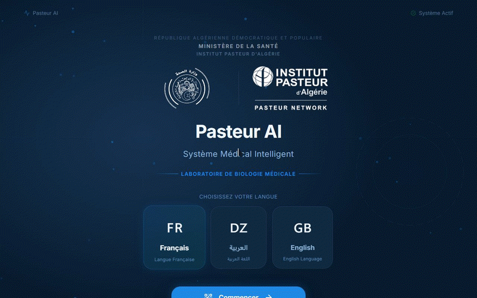

### 2. AI processing — *"What is the system doing with my report?"*

Five transparent steps tick by — QR detected, report download, biomarker extraction, AI interpretation, dashboard preparation — so the patient knows exactly what is happening before the dashboard appears.

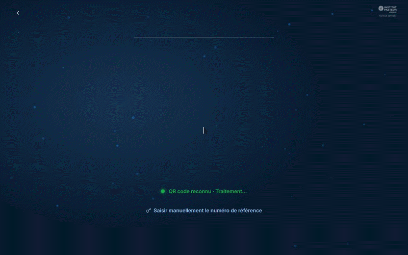

### 3. Dashboard tour — *"How am I doing overall?"*

The patient card, the **80/100 health score ring**, the AI summary, and the per-system dot-matrix (Sang, Foie, Thyroïde…) are toured top to bottom, then the **Graphiques** tab shows the biomarker charts.

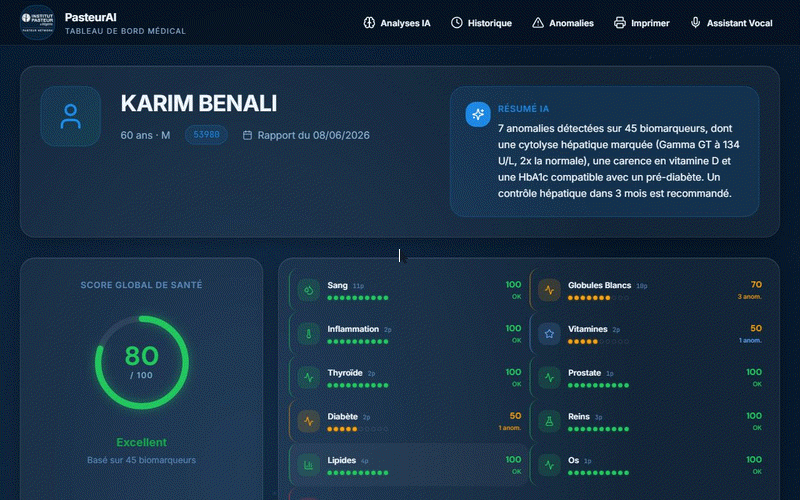

### 4. AI insights — *"Why is my Gamma GT high?"*

The **Analyses IA** screen: filter by severity, read each finding (cause, confidence, recommendation), then ask the assistant a follow-up question and get a personalized answer grounded in the report.


### 5. Anomaly explorer — *"Show me only what is wrong"*

The **Anomalies** screen groups findings into Critique / Anormal / Alerte. The patient drills from the critical *Gamma GT 134 U/L* row into the liver biomarker detail with reference-range charts.

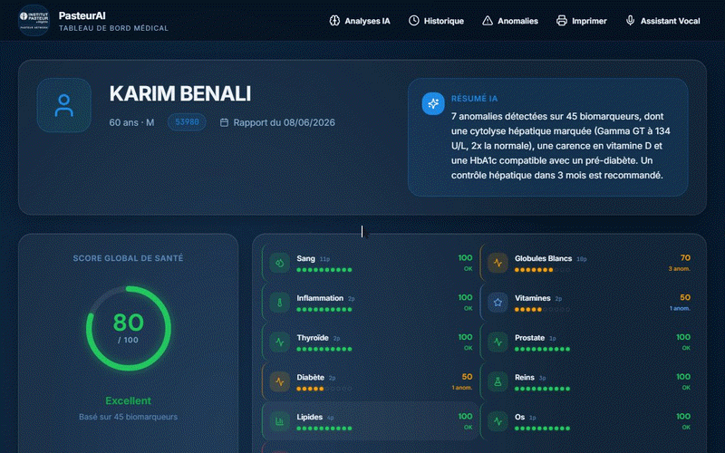

### 6. History timeline — *"Is it getting better over time?"*

Four past reports (Jan → Jun 2026) on a timeline with the health-score trend — the Gamma GT trajectory 180 → 134 U/L shows steady improvement.


### 7. Print & export — *"I need a copy for my doctor"*

The **Imprimer** screen generates a one-page summary (patient, ref, score, AI availability) with a simulated printer and PDF export.

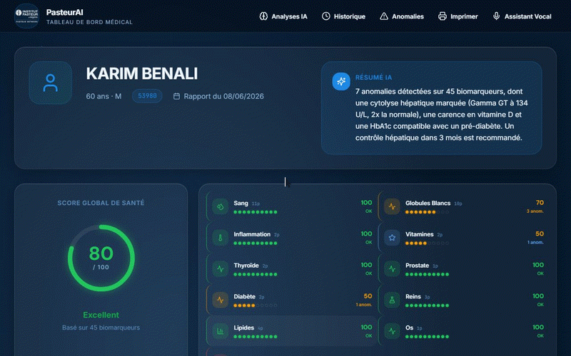

### 8. Voice assistant — *"Can I just ask?"*

A suggested question chip and then a (scripted) voice query — *"Pourquoi mon ALT est élevé ?"* — answered by the assistant in plain French.

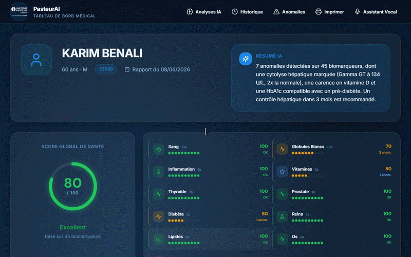

## Screenshots

| Screen | Preview |
| --- | --- |
| Home (FR) | 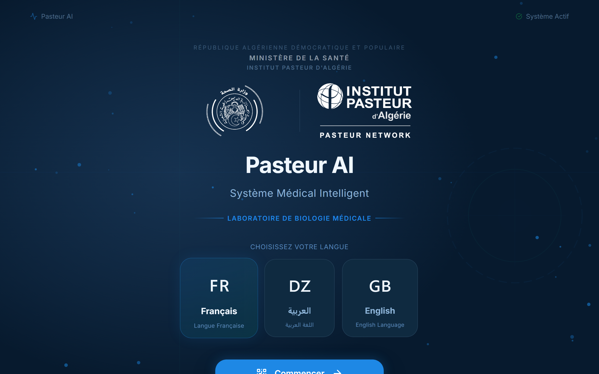 |
| Home (AR, RTL) | 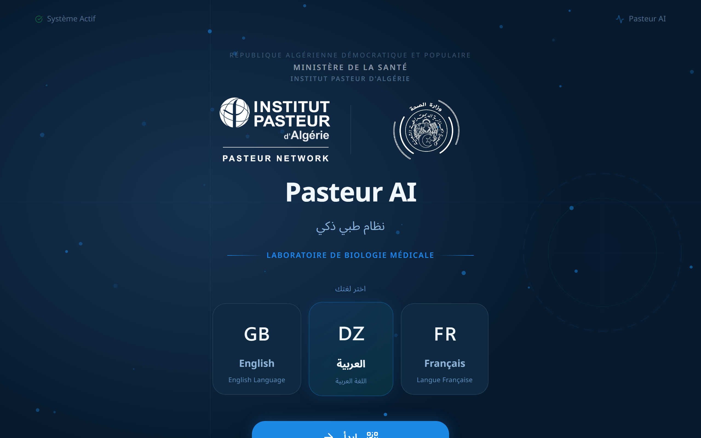 |
| Dashboard | 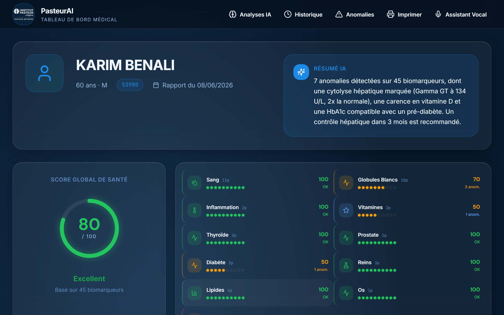 |
| AI insights | 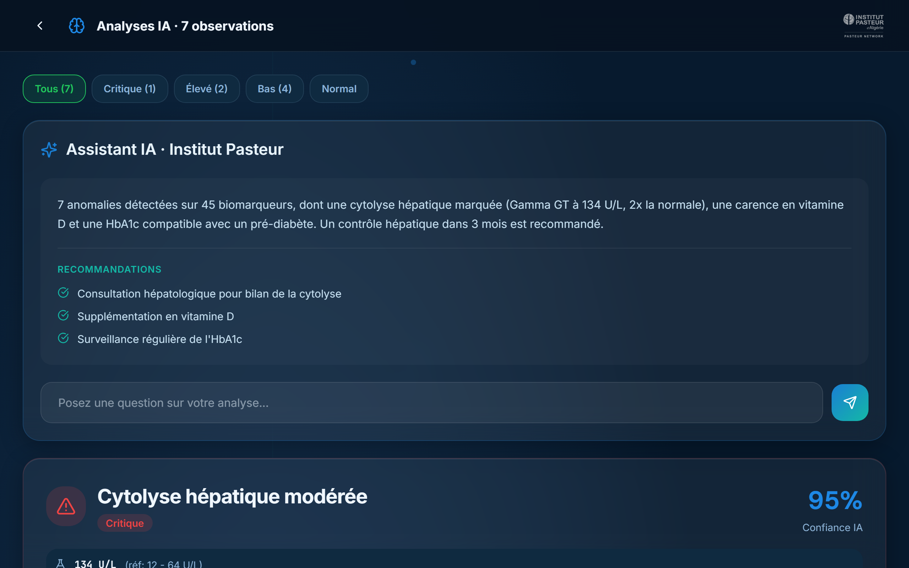 |
| Anomalies | 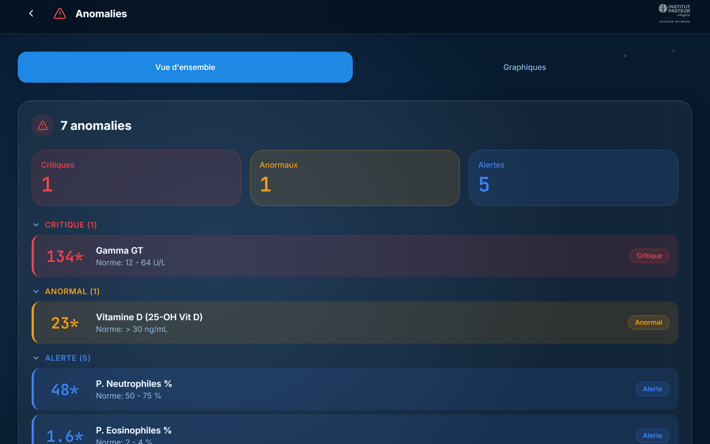 |
| Biomarker detail | 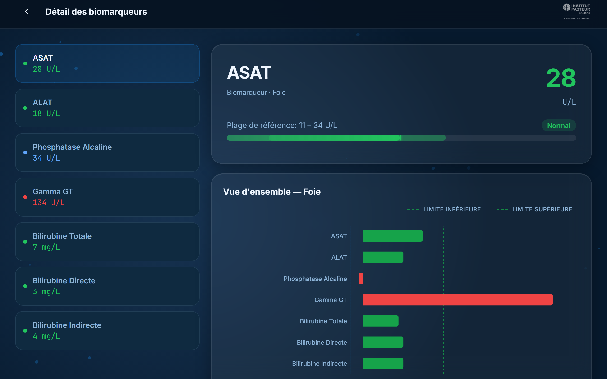 |
| History | 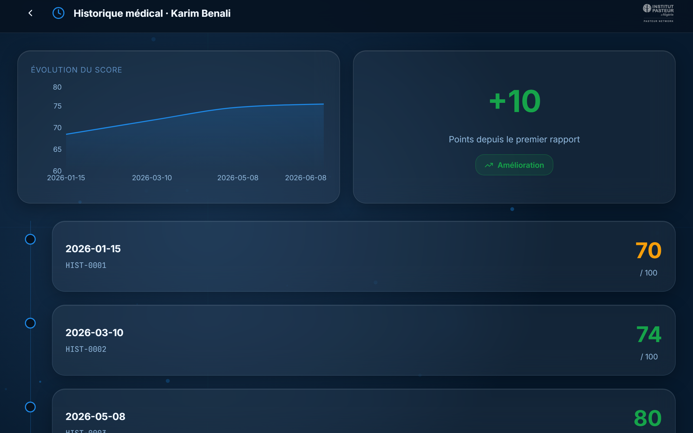 |
| Print | 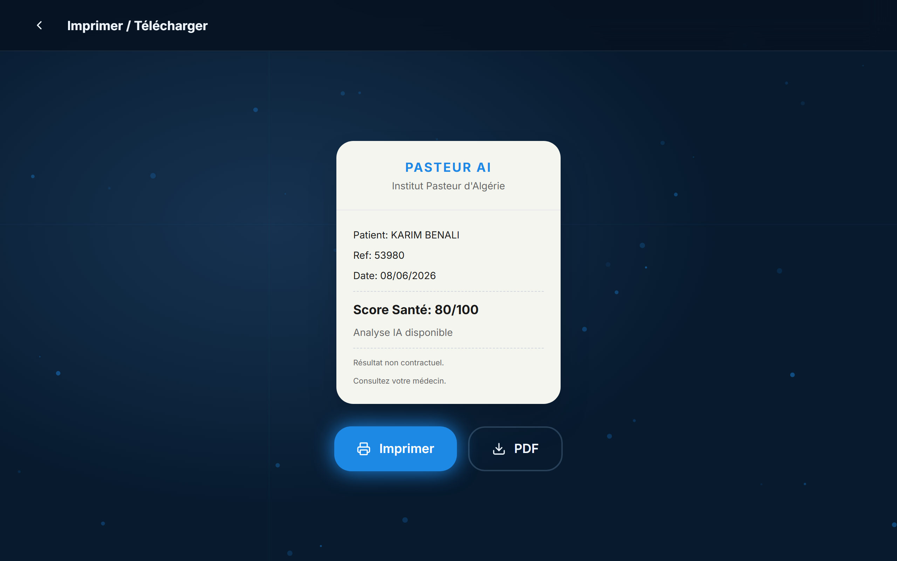 |
| Voice assistant | 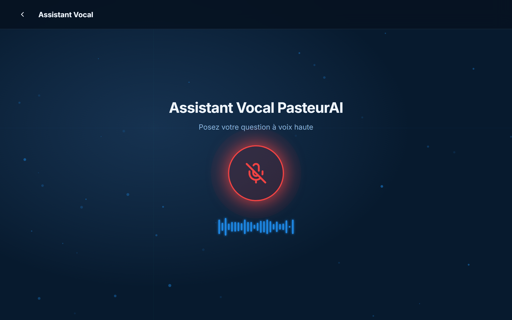 |

Full set (18 shots, incl. full-page captures): [`docs/screenshots/`](docs/screenshots).

## Stack

- **Frontend** — React 18 + Vite + Tailwind + Recharts + lucide-react (`frontend/`)
- **Backend** — FastAPI + PostgreSQL pipeline (`backend/`), CLI in `main.py` (download → parse → AI)
- **AI** — biomarker interpretation with report-grounded answers, FR / AR / EN

## Regenerating the demo assets

The GIFs and screenshots in `docs/` are generated by a Playwright harness — no backend or camera needed:

```bash
# 1. Start the frontend dev server
cd frontend && npx vite --host        # http://localhost:5173

# 2. Capture everything (18 screenshots + 8 GIFs)
.venv\Scripts\python scripts\capture.py
```

Useful flags:

```bash
python scripts/capture.py --only 3,5   # re-record specific GIF scenarios
python scripts/capture.py --no-gifs    # screenshots only
python scripts/capture.py --no-shots   # GIFs only
python scripts/capture.py --fps 12     # higher GIF frame rate
```

The harness mocks every `/api/*` call in the browser and replaces the camera with a synthetic canvas stream that presents a real QR code (`pasteur://report/r/53980`), so the real scan → detect → process flow runs end to end.
